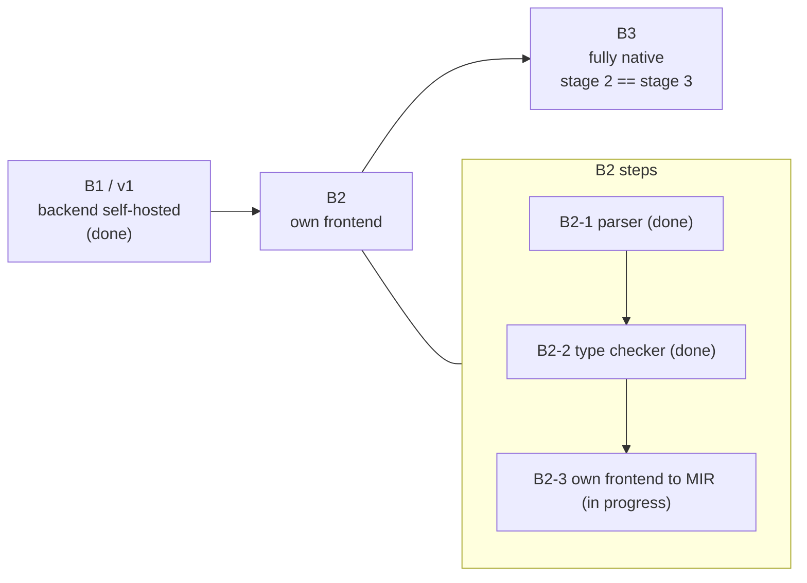

# Self-hosting and bootstrap

The compiler is written in Kotlin, and the goal is for Mini to compile itself into a native binary that needs no JVM. The plan splits that into stages. The backend's own code is held to a **purity rule** from the start: `compiler/backend` may not use `java.*`, `javax.*`, `kotlin.jvm.*`, `@Jvm*`, reflection or `System.*`, and a test (`PurityTest`) fails the build on any violation. All contact with the JVM sits in `compiler/jvm-bridge`.



## v1 and B1: the backend compiles itself

The v1 milestone is that `minic` compiles its own backend (pure Kotlin) and that the native result produces **byte-identical C** to the JVM backend for all test programs.

- `minic emit-mir file.kt -o out.mir` runs the frontend and writes the [MIR](./mir) as text.
- `compiler/native-driver` is a `fun main(args)` that reads a `.mir` file and runs `CEmitter`. Its file access is the Mini stdlib API `mini.io.readTextFile` and `writeTextFile`.
- `minic` builds `native-driver` plus `backend` natively into `minic-backend`.
- `SelfHostTest` (part of `gradle test`) checks it three ways: the driver on the JVM versus natively, byte-identical; the native build under ASan and UBSan (no memory error, no undefined behavior, no direct leak; reference cycles in `LinkedHashMap` show up as indirect leaks and are tolerated); and the B1 acceptance test, where for every `compiler/testdata` program `emit-mir`, then native `minic-backend`, gives C identical to the JVM `CEmitter`.

You can reproduce the first half yourself, as in the README:

```sh
./minic build $(find compiler/native-driver/src/main/kotlin compiler/backend/src/main/kotlin -name '*.kt') -o build/minic-backend
./minic emit-mir examples/shapes.kt -o build/shapes.mir     # frontend: K2, still on the JVM
build/minic-backend build/shapes.mir -o build/shapes.c       # backend: native
clang -std=c17 -O2 -Iruntime/include build/shapes.c runtime/src/*.c -lm -o build/shapes
```

Getting here forced the features real Kotlin needs: generics, lambdas, exceptions, `inline`, `sealed`, the stdlib collections and `StringBuilder`. That is why those are well covered.

## B2: an own frontend

K2 depends on Java code, so a JVM-free compiler needs its own frontend, written in Kotlin and compiled by Mini. K2 stays as an **oracle**: differential testing replaces having no reference.

- **B2-1, lexer and parser (done).** A hand-written lexer and recursive-descent parser produce a lossless CST (printing it reproduces the source byte for byte) and a typed AST. Agreement with K2's PSI tree: 0 mismatches on the repository sources, about 230 tricky snippets, 30k random expressions, 20k random declarations and about 12k mutated files.
- **B2-2, name resolution and type checking (done).** Symbols, types with variance, inference with a constraint solver, call resolution, smart casts. Compared position by position with K2's FIR: **86658 of 86668 positions agree (99.99 %)** across the stdlib, the compiler sources, the test programs and the examples. Built natively it gives the same result as on the JVM.
- **B2-3, own frontend to MIR without K2 (in progress).** The goal is for every test program to lower to MIR identical to the K2 path. The project README reports that on the working branch all 47 test programs already do, including from a natively built K2-free `minic-native`. This is not the default path yet.

## B3: fully native

`minic` compiles itself without a JVM: stage 1 is built by the JVM compiler, stage 2 by stage 1, stage 3 by stage 2, and the build is accepted when stage 2 equals stage 3. This is the **next** milestone and is not done.

## After the bootstrap

Planned: the compiler uses its own memory model (an `Arena` per compiler phase, Strict mode in hot paths), and the C runtime is rewritten in Kotlin. See the [roadmap](/roadmap).
