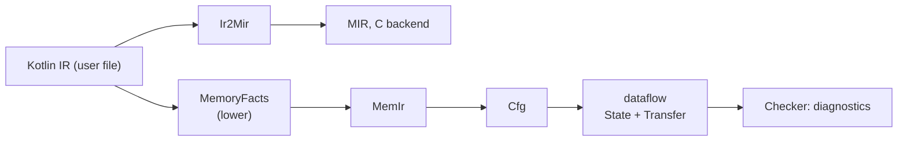

# Memory checker

The Strict-mode checker implements the [memory model](/memory/). It lives in `compiler/backend/.../memory` (pure Kotlin, subject to the purity rule, so it will self-host) with one adapter in `jvm-bridge`.

## Stages

- **`MemoryFacts` (lower; the K2 path has its own in tools/k2-oracle)** lowers the Kotlin IR of the user file to **MemIr**, a second view of the same IR. The C-oriented MIR cannot carry what the checker needs: source positions, `@Owned`, `@Borrowed`, `@MemoryMode`, `@AllocatedBy`, `@NoAlloc`, `@ThreadBoundary`, context parameters, allocator objects, and calls to `free`, `move`, `use` and `close`. Inline lambdas (`use`, `context`, `run`, `let`, `repeat`, `forEach`, ...) become scope blocks read like code; thread-boundary lambdas are scopes whose captured owners move in; all other lambdas are analysed separately.
- **`Cfg`** builds a control-flow graph per function (and per escaping lambda). A stack of frames (scope locals, loops, `finally` bodies, `use` closes, thread-lambda ends, try handlers) makes every leaving edge (end of scope, `return`, `break`, `continue`, `throw`) run the right exit operations. `finally` bodies are copied into each exit path, and leaks are checked per path, which is why messages name the path kind.
- **`State`** is the abstract domain. A tracked slot holds a *set* of states (`Owned`, `Null`, `Freed`, `Moved`, `Borrowed`, already-reported); the join at a merge is the union, which is the specification's `Maybe`. It also records which owner slots an alias borrows from, and the allocation sites of the value (position, allocator kind and identity). Field states (`local.field`: unknown, null, owned, moved-out) support overwrite leaks and partial moves.
- **`Transfer`** holds the transfer functions: allocator resolution per allocation site, moves and borrows, function summaries from annotations, arena scopes (M0105, M0106, M0115, M0202), thread boundaries (M0206), `@NoAlloc` (M0205), field moves (M0113) and annotation checks (M0111).
- **`Checker`** is the driver. Per function: build the CFG, iterate the forward dataflow to a fixpoint with reporting off, then one reporting pass over the stable block entry states. Diagnostics are deduplicated by code and position, and a leak of a slot that already has a use, free or move error is dropped, so **one cause gives one message**.
- **`Diagnostics`** renders the rustc-like output. Only the code and the primary position are stable.

## Properties worth knowing

- **Local.** A function is checked from its own body and the signatures of its callees. There is no inference across function boundaries; parameter conventions come from `@Owned` / `@Borrowed` and the defaults.
- **Independent of placement.** Whether an object ends up on the stack, in an arena or on the heap never changes whether a program is accepted, so diagnostics do not change when optimizations do.
- **Managed functions are not analysed**, except for the boundary rule M0110.
- **Approximations** are deliberate: exception edges only at `throw` and `require`-like calls, loans hang on the receiver and all borrowed arguments, partial moves go one level deep. They are listed in the memory model specification.

## How it is tested

`MemoryCheckTest` runs the checker on every program in `compiler/testdata/memory/` (`.diag` holds the exact expected `line:col: CODE` multiset; no `.diag` means no diagnostics at all) and on extra programs in `compiler/testdata/memory-extra`. `MemoryCorpusTest` compiles the corpus with the real `kotlinc` to make sure the programs are valid Kotlin. `MemoryRunTest` builds the accepted programs natively where the backend can; programs using context parameters, allocator objects or lambdas in ways `Ir2Mir` does not lower yet are skipped, which is the D2 work item on the [roadmap](/roadmap). The [diagnostics reference](/reference/diagnostics/) is generated from this same corpus.
