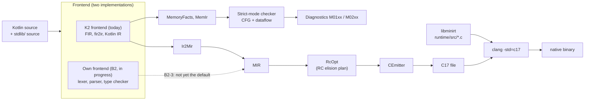

# How it works: the pipeline

`minic` is a Kotlin compiler with a custom backend. It reuses a Kotlin frontend to understand your source, lowers the result to its own mid-level IR (**MIR**), optimizes reference counting, emits plain **C17**, and lets **clang** compile that C together with a small C runtime, **libminirt**.

## The stages

| Stage | Where | What it does |
|---|---|---|
| Frontend | `tools/k2-oracle/jvm-bridge` (K2; the shipped `minic` uses the own frontend) | Parses and type-checks your files together with all of `stdlib/`. Runs the real Kotlin K2 compiler (pinned to 2.4.21) on the JVM, with `-no-stdlib -no-jdk`, so `kotlin.*` comes from Mini's own sources. A compiler plugin receives the Kotlin IR after fir2ir and before any JVM lowering. |
| Reachability | `jvm-bridge` | Drops every stdlib declaration the program cannot reach, so `println("x")` becomes about 66 lines of C. |
| `Ir2Mir` | `jvm-bridge` (`Ir2Mir*.kt`) | Translates the Kotlin IR to MIR: classes, vtables, closures, inline expansion, exceptions, boxing. Anything it does not understand is a compile error, never wrong C. |
| Memory checker | `backend/.../memory` | For Strict files, a second view of the same IR (`MemoryFacts` to `MemIr`) goes through CFG construction and a dataflow analysis. Errors stop the build before code generation. See [Memory checker](./checker). |
| MIR | `backend/.../Mir.kt` | The mid-level IR: structured, typed, C-oriented. See [MIR](./mir). |
| `RcOpt` | `backend/.../RcOpt.kt` | Computes an `RcPlan` per function: which locals borrow instead of owning, which last uses move, which constructor parameters are owned. See [Reference counting and RcOpt](./refcounting). |
| `CEmitter` | `backend/.../CEmitter.kt` | Writes C17 using GNU statement expressions. Placement of retain and release follows the plan. |
| clang | external | Compiles the C with `-std=c17 -O1 -Wall` and links libminirt, whose sources are compiled together with the program (there is no separate library build). |

## Two frontends

Today every build goes through K2. The long-term goal is a compiler written in Kotlin that compiles itself without a JVM, so a second frontend (lexer, parser, type checker) is being written in `compiler/frontend`, with K2 as a test oracle. See [Self-hosting and bootstrap](./bootstrap) for how far that is.

## The same program at every stage

A small program, [`counter.kt`](https://github.com/HenrySchwerdt/mini/blob/main/website/samples/internals/counter.kt), that CI builds and runs:

<<< @/samples/internals/counter.kt{kotlin}

<<< @/samples/internals/counter.out{text}

Its MIR is on the [next page](./mir), its C a little further down on the same page.

## Module layout

| Module | Role | JVM APIs allowed? |
|---|---|---|
| `compiler/backend` | MIR model, name mangling, `RcOpt`, `ThrowAnalysis`, `CEmitter`, memory checker | no (pure Kotlin, enforced by a test) |
| `compiler/native-driver` | reads a serialized `.mir` file and writes C; the entry point of the self-hosted backend | no |
| `compiler/frontend` | own lexer, parser, typed AST and semantic analysis | no |
| `tools/k2-oracle/frontend-oracle` | tests that compare the own frontend against K2 | yes (tests only) |
| `tools/k2-oracle/jvm-bridge` | drives K2, `Ir2Mir`, the CLI, starts clang | yes, the only module that touches compiler internals |

The "purity rule" (no `java.*`, no `kotlin.jvm.*`, no reflection in the backend) is what makes self-hosting possible: the backend must be compilable by Mini itself.
